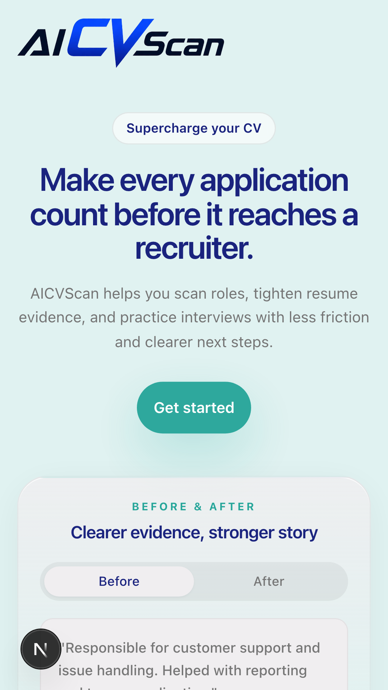
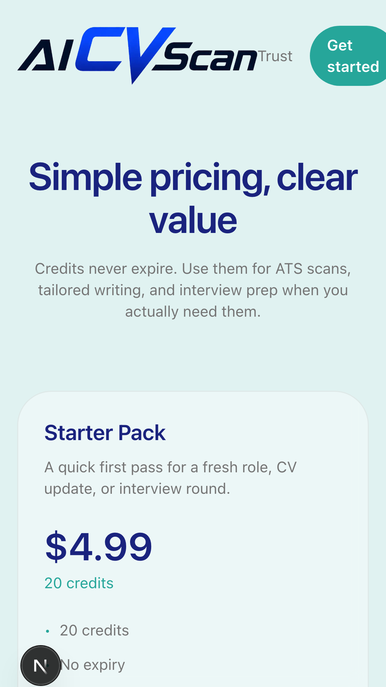
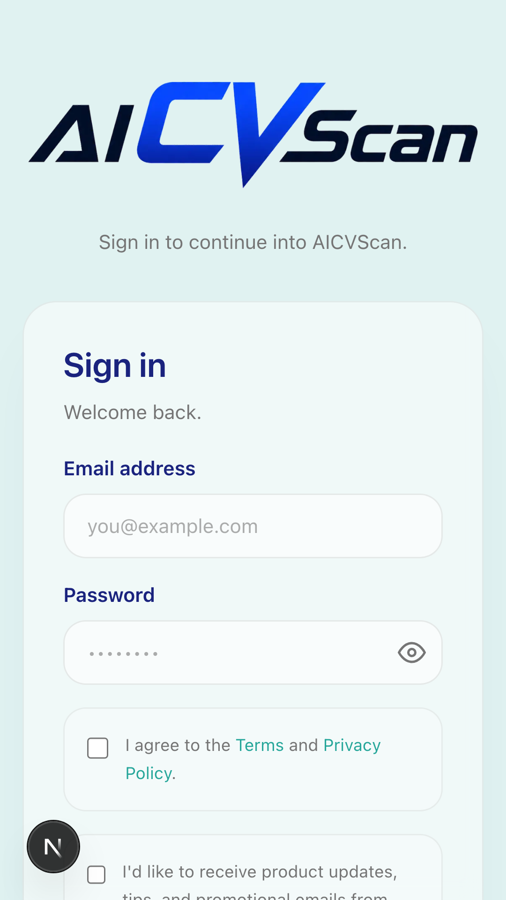

# AI CV Scan (CVScan)

AI CV Scan helps job seekers tailor their applications. Scan a job posting, see which resume evidence matches and which keywords are missing, rewrite your CV and cover letter for the role, and practise interview answers.

- **Web app:** https://www.aicvscan.com
- **Android app:** Google Play, package `com.cvscan.app` (Capacitor wrapper around the web app)
- **Support:** support@aicvscan.com · **Privacy:** privacy@aicvscan.com



| Pricing | Sign in |
| --- | --- |
|  |  |

## Features

- **Job fit analysis:** compares a CV against a job posting and surfaces evidence and keyword gaps.
- **Tailoring:** generates role-specific CV and application content.
- **Interview practice:** practice questions and answer feedback.
- **Accounts and credits:** sign-in with NextAuth (email and Google). Credits can be bought via Stripe on the web or Google Play on Android.
- **Account deletion:** available in-app and at `/delete-account`.

## Tech Stack

- Next.js 16 (App Router), React 19, TypeScript, Tailwind CSS
- NextAuth for authentication (authentication is **enabled**; sign-in is required for account features)
- Supabase for application data
- Stripe for web payments, Google Play Billing for Android
- Google Gemini and OpenAI for AI features
- Capacitor for the Android build
- Playwright for end-to-end tests

## Getting Started

Requires Node.js 20+ and npm.

```bash
cd app
cp .env.example .env.local   # then fill in your own values
npm install
npm run dev
```

The dev server runs at http://localhost:3000. Never commit `.env.local` or any real credentials.

### Environment variables

Names only; see `app/.env.example` for the template.

| Area | Variables |
| --- | --- |
| Supabase | `NEXT_PUBLIC_SUPABASE_URL`, `NEXT_PUBLIC_SUPABASE_ANON_KEY`, `SUPABASE_SERVICE_ROLE_KEY` |
| Auth | `NEXTAUTH_SECRET`, `NEXTAUTH_URL`, `GOOGLE_CLIENT_ID`, `GOOGLE_CLIENT_SECRET` |
| Stripe | `STRIPE_SECRET_KEY`, `STRIPE_PUBLISHABLE_KEY`, `STRIPE_WEBHOOK_SECRET`, `STRIPE_PRICE_STARTER`, `STRIPE_PRICE_PRO`, `STRIPE_PRICE_ENTERPRISE` |
| AI | `GEMINI_API_KEY`, `OPENAI_API_KEY` |
| Google Play | `GOOGLE_PLAY_PACKAGE_NAME`, `GOOGLE_PLAY_WEBHOOK_TOKEN`, `GOOGLE_PLAY_SERVICE_ACCOUNT_JSON` |
| Email | `SMTP_HOST`, `SMTP_PORT`, `SMTP_USER`, `SMTP_PASSWORD`, `EMAIL_FROM` |

## Build, Lint, and Test

From `app/`:

```bash
npm run lint
npm run build
npm run e2e      # Playwright
```

## Android (Google Play)

The Android project in `android/` wraps the hosted web app using Capacitor (`capacitor.config.ts`). Set `CAPACITOR_SERVER_URL` to point at a different deployment.

- Release builds are signed with your own upload keystore, supplied through GitHub Actions secrets (`.github/workflows/android-release.yml`). Keystores are git-ignored and must never be committed.
- Play Billing server notifications are received at `/api/google-play/webhook` and authenticated with `GOOGLE_PLAY_WEBHOOK_TOKEN`.

## Deployment

The web app deploys to Vercel (`vercel.json`). Set all environment variables in the Vercel project settings.

## Repository Layout

```text
cv-scan/
├── app/         # Next.js application
├── android/     # Capacitor Android project
├── docs/        # product, architecture and reference docs
├── contracts/   # JSON schemas for project metadata
├── data/        # local data (not tracked)
├── scripts/     # automation scripts
└── README.md
```

## Security

Report vulnerabilities to support@aicvscan.com. Do not open public issues for security problems.

## License

All rights reserved. See [LICENSE](LICENSE).
